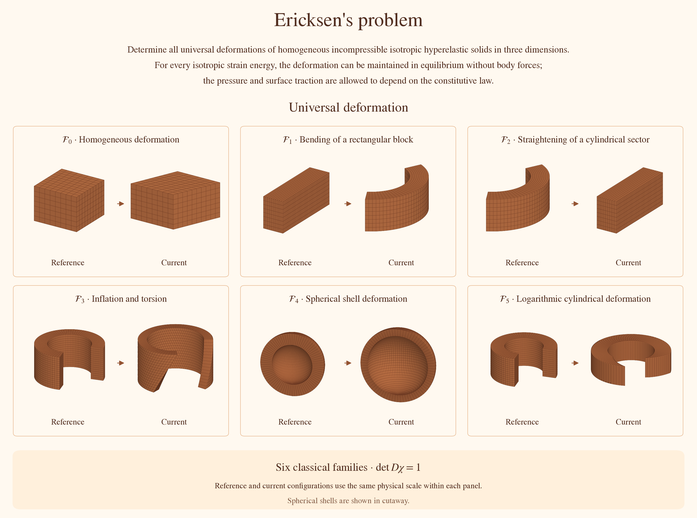
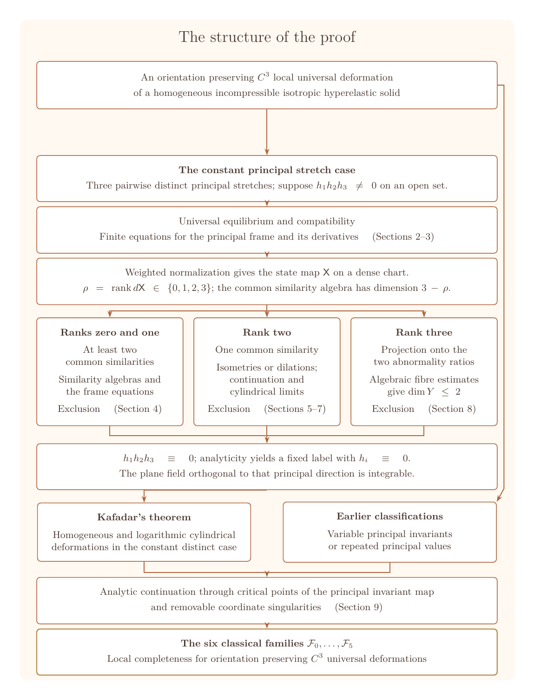

# A local solution of Ericksen's problem

[](https://doi.org/10.5281/zenodo.23330905)

**Jingbei Bai** · Xingjian College, Tsinghua University

[bjb23@mails.tsinghua.edu.cn](mailto:bjb23@mails.tsinghua.edu.cn)

[Read the paper](A%20local%20solution%20of%20Ericksen%27s%20problem.pdf) ·
[LaTeX sources](tex/) · [Ranks 0–2](Rank012/) · [Rank 3](Rank3/)



Ericksen's problem asks for all universal deformations of homogeneous
incompressible isotropic hyperelastic solids. A universal deformation can
be maintained in equilibrium without body forces for every isotropic
strain energy; the pressure and surface traction may depend on the
constitutive law. The illustration shows representatives of the six
classical families $\mathcal F_0,\ldots,\mathcal F_5$ defined in Section 2.2:
homogeneous deformation, bending, straightening, inflation and torsion,
spherical shell deformation, and logarithmic cylindrical deformation.

The paper proves local completeness of the six classical families for
orientation preserving $C^3$ universal deformations, including their
regular Cartesian continuations. Its principal step concerns three
distinct constant principal stretches: one principal direction is locally
normal to a family of surfaces. Analyticity and the earlier classifications
then yield the full local classification.

## Proof structure



Here $h_i$ is the abnormality of the $i$th principal direction,
$\mathsf X$ is the normalized state map, and $Y$ is the Zariski closure
of its image. Ranks zero, one and two are excluded through common
Euclidean similarities and the frame equations. At rank three,
projection onto the two abnormality ratios gives an algebraic dimension
bound that contradicts the rank of the state map. Section 9 joins this
argument to the classical classifications and continuation results.

## Repository contents

| Location | Contents |
|---|---|
| [Paper PDF](A%20local%20solution%20of%20Ericksen%27s%20problem.pdf) | The complete article, appendices and supplementary calculations in one PDF. |
| [tex/](tex/) | `main.tex`, the integrated `supplement.tex`, and all three required figure backgrounds. |
| [Rank012/](Rank012/) | SageMath sources and required inputs for ranks zero, one and two. |
| [Rank3/](Rank3/) | SageMath sources and required inputs for rank three. |
| [assets/](assets/) | README figures and their Python and TeX sources. |
| [VERIFICATION.json](VERIFICATION.json) | Recorded executions, fixed environment, manuscript hashes and file inventory. |
| [SHA256SUMS.txt](SHA256SUMS.txt) | SHA-256 checksums for the distributed files. |

Each calculation directory contains `PROOF_MAP.md` for the mathematical
index, `PROOF_MAP.json` for the exact algebraic statements and dependencies,
`SYMBOLS.md` for notation, `tasks.json` for the execution graph, and
`MANIFEST.json` for source and input hashes. The `.tex` files under
`inputs/paper/` are exact formula excerpts consumed by the programs.

## Reproduce the calculations

Clone the repository and run the following commands from its root on
Linux x86_64, or in WSL on Windows. Conda or Miniforge installs the fixed
environment from the explicit lock file.

```sh
conda create --prefix ./sage-environment --file Rank012/environment-linux-64.lock -y
./sage-environment/bin/python Rank012/run.py --work-dir ./rebuild-rank012 --workers 2
./sage-environment/bin/python Rank3/run.py --work-dir ./rebuild-rank3 --workers 2
```

The environment contains SageMath 10.9, Python 3.12.14 and SymPy 1.14.0;
all dependency versions and builds are fixed. Both calculation directories
contain the same lock file. Allow at least 16 GiB of RAM for the complete
calculation; `--workers 1` reduces concurrent memory use.

A new run requires a new work directory. The runner resolves dependencies
and builds the generated inputs. Outputs and logs appear under the work
directory's `run/` subdirectory. To continue an interrupted run, repeat
its command with `--resume`.

To select a mathematical part together with its prerequisites:

```sh
./sage-environment/bin/python Rank3/run.py --list-proofs
./sage-environment/bin/python Rank3/run.py --proof ID --work-dir ./rebuild-part --workers 1
```

Replace `ID` with an entry returned by `--list-proofs`. For example,
`C9_ENDPOINT` selects the relative conic ideals in Appendix C.9. The
corresponding recorded exact outputs and labelled coefficient matrices
are in [Rank3/results/conic_endpoint/](Rank3/results/conic_endpoint/).

The [boundary index](Rank3/BOUNDARY_INDEX.md) relates the five valuation
regions and all 73 intermediate coordinate support patterns to the local
ideal arguments and calculation nodes in Section 8 and Appendix C.7–C.9.
The [JSON index](Rank3/BOUNDARY_INDEX.json) includes the source interfaces,
dependency closures and exceptional parameter loci. Check it with:

```sh
./sage-environment/bin/python Rank3/validate_boundary_index.py
```

Compare the calculation indices with the included manuscript sources:

```sh
./sage-environment/bin/python Rank012/paper_index.py --paper tex/main.tex --supplement tex/supplement.tex
./sage-environment/bin/python Rank3/paper_index.py --paper tex/main.tex --supplement tex/supplement.tex
```

## Recorded verification

| Calculation | Mathematical tasks covered | Generated input copies covered |
|---|---:|---:|
| Ranks 0, 1 and 2 | 63 / 63 | 0 |
| Rank 3 | 376 / 376 | 149 / 149 |

The table counts distinct tasks across the recorded runs.
`VERIFICATION.json` gives their selections, run identifiers and hashes.
Rank 3 includes exact integer interpolation at 2039 and 965 nodes and
the boundary source and coefficient checks in BC30–BC33, together with
the first integrals on the intermediate incidence charts.

Verify the distributed files from the repository root:

```sh
sha256sum --check SHA256SUMS.txt
```

## Citation and licenses

Citation information is in [CITATION.cff](CITATION.cff).
The paper and original figures use [CC BY 4.0](LICENSE-CC-BY-4.0.txt);
the original programs use [MIT](LICENSE-MIT.txt).
See [LICENSE.md](LICENSE.md) for the file-specific scope and font license.
